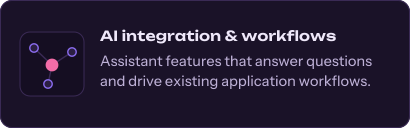
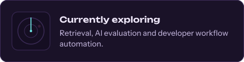
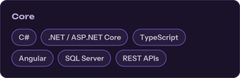
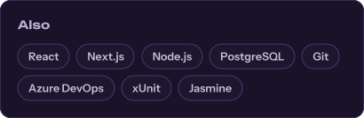

I build reliable software that makes complicated problems easier to solve. Professionally, I work on enterprise financial platforms and data-intensive workflows spanning C#/.NET, Angular, TypeScript, and SQL Server. I enjoy owning a problem from architecture and APIs through UI, testing, and delivery.

Outside of work, I build independent products and explore AI-assisted engineering, interactive systems, and game development.

**[Portfolio](https://maxmosier.com) · [LinkedIn](https://www.linkedin.com/in/max-mosier/)**

## 

   

## 

 

## 

 

## 

Good engineering is more than writing code that works today. I care about understanding the problem, making defensible tradeoffs, and leaving the codebase easier to work with than I found it.

## 

I'm into strategy games, sci-fi, game development, music production, and digital experiences with a little atmospheric nostalgia.

**[See more of my work →](https://maxmosier.com)**
